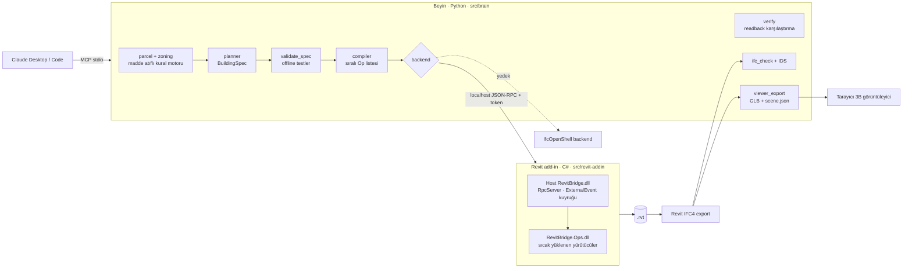

# Claude ↔ Revit · Parselden İmar Denetimli BIM Modeline

Gerçek bir parselden (Konya / Karatay / Büyüksinan, ada 1495, parsel 26) başlayıp imar kurallarını denetleyen, **3 katlı bitişik nizam apartmanı Revit 2027'de üreten**, sonucu otomatik test edip **IFC4 + IDS** ile doğrulayan ve klinker tuğla cepheyi tuğla tuğla modelleyen sistem.

> **Tek cümle:** LLM niyeti tarif eder (`BuildingSpec`), geometriyi deterministik bir derleyici kurar, Revit add-in'i op'ları idempotent uygular, test motoru modeli okuyup spec'le karşılaştırır.

## Dürüstlük notu (önce bunu oku)
| Konu | Durum |
|---|---|
| İmar değerleri (TAKS 0.40, KAKS 1.20, Hmax 10.5 m, 3 kat, çekmeler 5/3/0/3) | **DEMO VARSAYIMI** (`data/imar-durumu/demo.yaml`, `verified:false`). Parselin gerçek imar durumu belgesi elde değil. |
| Parsel geometrisi | TKGM'den gerçek; koordinat doğruluğu yaklaşık ±1 m. |
| Revit | 2027.3 **TRIAL / ticari olmayan** sürüm. Add-in bu sürümde çalıştırılıp doğrulandı. |
| BIM yönetmeliği (RG 05.08.2026-33331) | Metin okundu; EK-5/EK-6 okunamadı → IDS profili genel IFC4 profilidir, **yönetmeliğe uygunluk iddia edilmez**. |
| Parsel üzerindeki mevcut iki 5 katlı bina | Modellenmedi. |
| Parapet | Yok (çatı düzeyinde korkuluk duvarı eksik). |
| Planlayıcı | Dışbükey yapılaşma alanı, ön kenara paralel dikdörtgen ayak izi. |
| MEP / yapısal / yangın kaçış genişliği / aydınlatma oranı | Kapsam dışı. |

Ayrıntılı tablo: [docs/00-genel/04-dogrulama-tablosu.md](docs/00-genel/04-dogrulama-tablosu.md).

## Mimari


Tasarım kararları ve gerekçeleri:
- **Spec + derleyici, düşük seviyeli araç yok.** Claude `create_wall` çağırmaz; yapılandırılmış spec üretir. Böylece sonuç tekrarlanabilir, test edilebilir, ID'ler kararlıdır (`spec_id` içerik özetidir).
- **Idempotent reconcile.** Her eleman ExtensibleStorage'ta `SpecRef/OpHash/SpecId` taşır. Aynı komut ikinci kez → 0 değişiklik; kat yüksekliği değişirse yalnız etkilenenler güncellenir.
- **Atomik uygulama.** Bir `apply` = bir `TransactionGroup`; hata → rollback. `dry_run` her zaman geri alınır.
- **Tek yazıcı iş parçacığı.** RPC iş parçacığı Revit API'ye dokunmaz; `ExternalEvent` + `Idling` kuyruğu ana iş parçacığında çalıştırır.
- **Sıcak yükleme.** Yürütücüler ayrı derlemede (`RevitBridge.Ops.dll`); dosya değişince Revit'i kapatmadan yeniden yüklenir.
- **Tek mesh / panel klinker.** Her cephe paneli tek DirectShape mesh (tuğla + derz); 41 882 tuğla, 209 410 yüz saniyeler içinde kurulur. LOD anahtarı: `full` / `courses`.
- **Bilinen etiket.** Doğrulanmamış hiçbir değer doğrulanmış gösterilmez; rapor üç yolu karşılaştırır (spec ↔ Revit ↔ IFC).

Daha fazla: [Sistem mimarisi](docs/02-mimari/01-sistem-mimarisi.md) · [Veri şemaları](docs/02-mimari/02-veri-semalari.md) · [Revit add-in tasarımı](docs/02-mimari/03-revit-addin-tasarimi.md).

## Sonuçlar (Revit 2027.3'te doğrulandı)
| Ölçüt | Değer |
|---|---|
| Blok / TAKS / KAKS | 2 blok · 0.399 · 1.197 (demo sınırları 0.40 / 1.20) |
| Duvar / mahal / kapı / pencere / merdiven | 204 / 102 / 88 / 68 / 4 |
| Merdiven | 19 rıht × 0.158 m, basamak 0.30 m (PAİY M31) |
| Klinker | 15 panel, 41 882 tuğla |
| Op sayısı | 595 (493 + 102 mahal etiketi) |
| `verify_model` | 0 fark |
| İdempotency | ikinci `apply` → 0 değişiklik |
| Rollback | bozuk op → model değişmez (gerçek Revit'te denendi) |
| Revit IFC4 | IDS 10/10 spec · sayılar spec'le tutuyor · mahal alanı 1294.8 m² (spec 1295.16) |
| Testler | `pytest` 159 geçiyor (Revit'siz; sahte Revit ile) |

## Hızlı başlangıç
Gereksinim: Windows, PowerShell, [uv](https://docs.astral.sh/uv/), .NET SDK (10), Revit 2027 (yalnız Revit adımları için).

```bash
uv sync
uv run pytest -q
```

### Revit'siz (imar, plan, dry-run, IFC, görüntüleyici)
```bash
uv run python tools/plan_demo.py
uv run python tools/mcp_smoke.py
```
Çıktılar `out/` altına yazılır (spec.json, ops.json, model.ifc, report.html).

### Revit ile
```powershell
./tools/install-addin.ps1        # iki derlemeyi derler ve %APPDATA%\Autodesk\Revit\Addins\2027\RevitBridge\ altına kopyalar
```
Revit'i aç (güvenlik penceresinde "Her zaman yükle"), sonra:
```bash
uv run python tools/mcp_smoke.py --build --fresh
```
Bu: parsel → imar → plan → `build_in_revit` → `verify_model` → `export_ifc` → rapor zincirini koşar.

### Claude'a bağlama (MCP)
`.mcp.json` depo kökünde hazır (Claude Code ilk kullanımda onay ister). Elle:
```bash
claude mcp add revit-demo -- uv run --directory <depo-dizini> python tools/mcp_server.py
```
Araçlar: `list_inputs`, `load_parcel`, `check_zoning`, `plan_building`, `validate_spec`, `build_in_revit`, `verify_model`, `export_views`, `export_ifc`, `generate_report`, `export_viewer`, `get_status`.

Örnek komutlar: *"Büyüksinan 1495/26'yı yükle, imar kontrolünü yap"* · *"Bina 4 kat olsun"* (→ imar motoru reddeder) · *"Kat yüksekliğini 2,90 m yap"* (→ diff) · *"Revit'te kur ve doğrula"*.

### Senaryolar ve rapor
```bash
uv run python tools/scenarios.py
```
S-A (altın yol), S-B (idempotency/değişiklik), S-C (ihlal yakalama), S-D (hata güvenliği), S-F (klinker) + pytest koşar; `out/test-report.md` ve `out/project-report.html` üretir.

### Tarayıcıda 3B model
```bash
uv run python tools/view.py --build
```
Revit IFC'sinden `out/viewer/` üretir ve `http://127.0.0.1:8765/` adresinde açar: döndür, kat ve eleman grubu aç-kapat, kesit kaydırıcısı, tıklayınca IFC bilgisi, parsel ve çekme çizgileri. İnternet gerekmez (three.js `src/viewer/vendor` altında, MIT).

## Klasörler
| Yol | İçerik |
|---|---|
| `src/brain` | Python çekirdeği (şemalar, parsel, imar, planlayıcı, derleyici, doğrulama, MCP, IFC) |
| `src/revit-addin` | C# add-in (host + sıcak yüklenen Ops) |
| `src/viewer` | Tarayıcı 3B görüntüleyici (three.js) |
| `tests` | pytest (sahte Revit ile) |
| `data` | Parsel, imar durumu (demo), kurallar, IDS |
| `tools` | Kurulum, çalıştırma, senaryo, görüntüleyici betikleri |
| `out` | Üretilen çıktılar |
| `docs` | Plan, karar kaydı, domain, yöntem, senaryolar |

## Plan haritası
[Vizyon](docs/00-genel/01-vizyon-kapsam.md) · [Karar kaydı](docs/00-genel/02-karar-kaydi.md) · [Risk](docs/00-genel/03-risk-kaydi.md) · [Parsel ve koordinat](docs/03-domain/01-parsel-ve-koordinat.md) · [İmar kuralları](docs/03-domain/02-imar-kurallari.md) · [Bina programı](docs/03-domain/03-bina-programi.md) · [BIM yönetmeliği](docs/03-domain/05-bim-yonetmeligi.md) · [Test stratejisi](docs/05-yontemler/01-test-stratejisi.md) · [Geometri](docs/05-yontemler/02-geometri-yontemleri.md) · [Demo senaryoları ve video planı](docs/06-senaryolar/01-demo-senaryolari.md) · [Fazlar](docs/07-fazlar/00-faz-ozeti.md) · canlı durum: [PROGRESS.md](PROGRESS.md)

## Sonraki adımlar
Parapet; imar durumu belgesinden (PDF) `ZoningParams` çıkarma; gerçek imar durumu ve Konya Büyükşehir imar yönetmeliği YAML'ı; parsel üzerindeki mevcut binaların modellenmesi; BIM yönetmeliği EK'lerine göre IDS.
